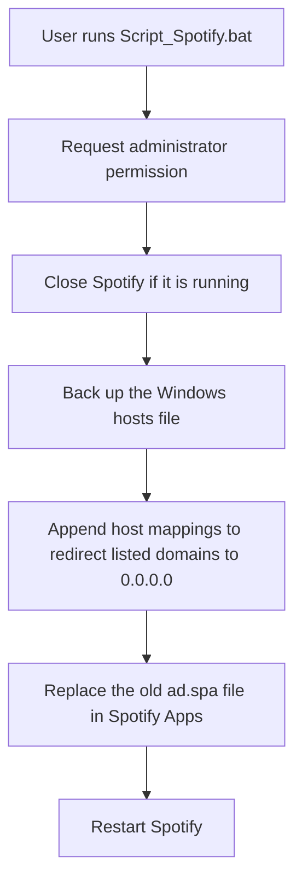

# Spotify-Premium-1.0.8

> [!WARNING]
> **ARCHIVED PROJECT: Spotify 1.0.8-era workaround. This project is discontinued and does not work with current Spotify.**
>
> This repository is preserved as an old project on my GitHub profile. It is not a current Spotify client and will not receive compatibility updates.

## What this project is

This project used the official Spotify 1.0.8 Windows installer from the 2020 era, alongside a small Windows batch script that applied an old ad-blocking workaround. It was designed for the Spotify client and service behaviour of that time.

The installer is the original official Spotify installer from that period, not a custom-built Spotify executable. The companion script is available in full for inspection: [`Script_Spotify.bat`](./Script_Spotify.bat).

## How the script works

The script is a Windows batch file. Its purpose was to apply host-based blocking for advertising-related domains used by the old Spotify client. It does not contain visible commands to read passwords, browser cookies, or Spotify credentials, nor does it contain code to transmit those credentials.

At a high level, it performs these steps:

### What it changes

- Requests administrator privileges because the Windows hosts file is a protected system file.
- Stops the running Spotify process before making changes.
- Creates a backup named `hosts.backup` in the Windows drivers/etc directory.
- Adds entries to the Windows hosts file that map listed hostnames to `0.0.0.0`, preventing the client from reaching those hosts.
- Deletes and recreates the old `ad.spa` file in Spotify's Apps directory.
- Starts Spotify again.

The hostnames in the script include advertising-related domains, but also `spclient.wg.spotify.com` and `audio2.spotify.com`, which are Spotify service endpoints. This old blocklist was specific to the client and service behaviour at the time. Blocking service endpoints can affect normal Spotify functionality, which is one reason this workaround is obsolete.

## Why people are reporting problems

Spotify has changed significantly since version 1.0.8. The old client and workaround are no longer compatible with the current Spotify service. Reports include:

- Spotify failing to launch or function correctly.
- Changed login and account flows, including unavailable sign-in options.
- Login or service errors such as error 409.
- Features and interface elements no longer matching the old client.

These are expected compatibility problems with an obsolete client and workaround. This repository is not being updated.

## About the virus claims

The visible batch script can be read directly in this repository. Its actions are described above: it edits the hosts file, replaces an old Spotify app resource, and restarts Spotify. It does not contain visible credential-stealing or credential-exfiltration commands.

The included Spotify installer is the original official Spotify 1.0.8 installer from the period this project was made. The project was an ad-blocking workaround for that old client, not a custom Spotify client designed to collect account credentials.

As with any old executable, users should make their own decisions about running archived software. The important distinction is that the visible batch script's actual operations are documented here, rather than inferred from the fact that it requests administrator access.

## Current status

This project is **discontinued**. It is kept public as a record of an older project I worked on, not as software for people to install today. I do not plan to update it for current Spotify versions or provide support for the old workaround.

If you're looking for Spotify today, use the official current application:

https://www.spotify.com/download/

---

Archived project. No compatibility updates or support are planned.
